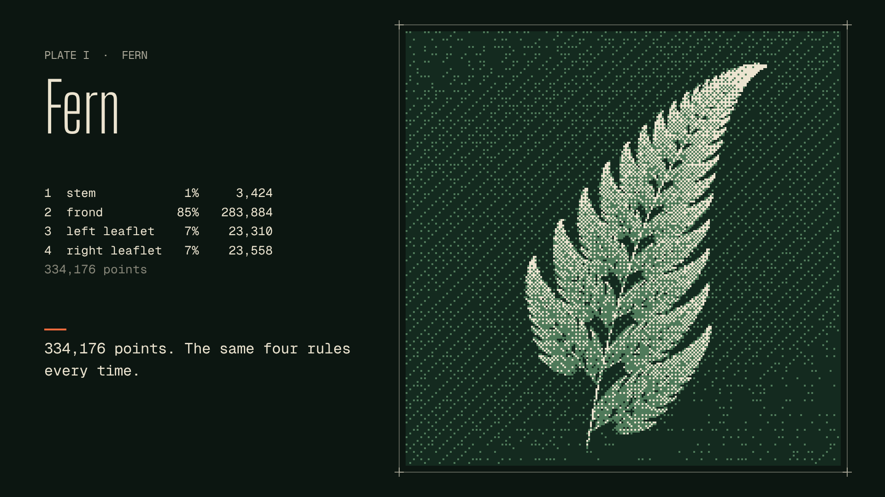

# Engravings, drawn live

A short silent film that draws a fern, a sunflower and the moon from their rules, one step at a time, rendered frame by frame from a browser canvas and encoded with FFmpeg.



Watch it on [speyyman.github.io/media/engravings-drawn-live/](https://speyyman.github.io/media/engravings-drawn-live/). The essay it goes with is [Four rules and a fern](https://speyyman.github.io/writing/four-rules-and-a-fern/).

| | |
|---|---|
| Length | 106 s at 30 fps, 3,180 frames |
| Cuts | 1920×1080 H.264 MP4 and VP9 WebM; 1080×1920 H.264 MP4 |
| Sound | None. Captions are drawn in the frame and also written as WebVTT |
| Plates | [plate-engine](https://www.npmjs.com/package/plate-engine) 0.1.0, dithered in three tones |

## Quick start

Needs Node 20 or later and FFmpeg on the PATH.

```sh
npm ci
npx playwright install chromium   # once, if Playwright has no browser yet
npm run render                    # builds the page, renders both cuts into out/ (about 12 minutes on a 4-core machine)
```

Faster ways in:

```sh
npm run render:preview                  # first 10 seconds of the landscape cut, quick encode
node scripts/render.mjs --stills 33,60  # PNG stills at those seconds, both cuts, into out/stills/
npm run dev                             # open the renderer in a browser; add ?t=40&o=portrait to scrub
```

Options for `scripts/render.mjs`: `--date` (the moon's moment, default `2026-10-23T00:00:00Z`), `--only landscape|portrait`, `--from` and `--to` (frame numbers), `--out`, `--ffmpeg`. Set `CHROMIUM_PATH` to use a particular Chromium.

Output in `out/`:

- `engravings-drawn-live-1920x1080.mp4`, `.webm`, and `engravings-drawn-live-1080x1920.mp4`
- `*-poster.png` and `*-poster.webp` (lossless, same pixels), the frame at 32 s
- `engravings-drawn-live.en.vtt`, the captions
- `*.frames.sha256`, a SHA-256 for every frame, so a re-render can be compared frame by frame

## How it works

- `src/scenes.ts` grows each plate as a pure function of how far its rule has run. The fern is the chaos game with Barnsley's four maps, run point by point; the sunflower places seed n at n × 137.508° and radius proportional to √n (Vogel's model); the moon is plate-engine's `moon` generator, engraved row by row and then lit for the date. At their last step the fern and the sunflower equal plate-engine's own plates cell for cell, which the tests check.
- `src/script.ts` is the timeline: scene times, how many points or seeds are shown at each moment, the moon's light, and the captions. The same captions are drawn in the frame and written to the WebVTT file.
- `src/draw.ts` paints a frame: the plate dithered with `ditherPlate` (Bayer 8×8, three tones) at 4 px per cell, its frame and registration marks, the plate label, a readout of the rule's state, and the caption.
- `scripts/render.mjs` serves the built page, opens it in headless Chromium, and for each frame calls `film.frame(i)`, reads the canvas back as PNG, hashes it and pipes it to FFmpeg (libx264 CRF 20; libvpx-vp9 CRF 34). Fonts are self-hosted, so frames do not depend on the machine's fonts.

Frames depend only on the frame number and the date, never on the clock or on earlier frames, so any stretch can be rendered on its own and comes out the same.

## Tests

```sh
npm test         # unit: scenes match plate-engine, timeline, captions, WebVTT
npm run e2e      # renders two stretches twice, compares every frame hash, probes the MP4s
npm run lint     # ESLint and Prettier
npm run typecheck
```

`npm run e2e` also checks the frames against a full render in `out/` when there is one.

## Limitations

- Rendering goes through a headless browser and takes minutes, not seconds. A Node canvas would be faster but would draw text differently from the browser.
- Frames are byte-identical across renders on the same machine and browser build. A different Chromium or a different platform may anti-alias the captions differently by a few pixels; the plates are computed in JavaScript and do not change.
- The moon's seas are approximate shapes placed by hand in plate-engine and its smaller craters are random. Only the light follows a rule, and the film says so.
- There is no audio track.

## Design

The film uses the palette and type of the site it was made for. See [DESIGN.md](DESIGN.md) for what it takes and why. Sources and licences are in [CREDITS.md](CREDITS.md).

## Licence

Code: MIT, see [LICENSE](LICENSE). The film, its stills and captions: [CC BY 4.0](https://creativecommons.org/licenses/by/4.0/).

The code was written with Claude, an AI assistant, under the author's direction.
